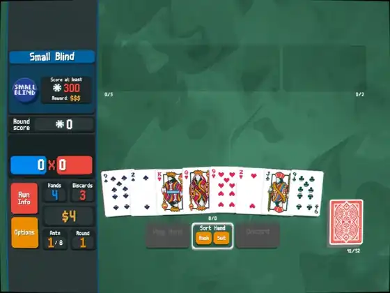

# Touch Trackpad

[](docs/media/demo.mp4)

Touch Trackpad turns your handheld's touchscreen into Steam Deck trackpads. Each half of the screen acts as one of
the Deck's trackpads, and Steam Input maps it like the real one: mouse, joystick, scroll wheel or radial menu. One
button switches back to the normal touchscreen.

It's a [Decky Loader](https://github.com/SteamDeckHomebrew/decky-loader) plugin, the Quick Access panel for
[armada-trackpad-daemon](https://github.com/nikitautiu/armada-trackpad-daemon).

> **Supported:** Retroid Pocket Nova on Armada OS (game mode). It's tested on that device only, so other devices
> and setups may not work.

## Install

1. Install the daemon on the device. Its [README](https://github.com/nikitautiu/armada-trackpad-daemon#install)
   explains each step.

   ```sh
   git clone https://github.com/nikitautiu/armada-trackpad-daemon
   cd armada-trackpad-daemon
   ./install.sh
   sudo ./scripts/system-files.sh install
   ```

2. Download `decky-armada-trackpad-<version>.zip` from the
   [latest release](https://github.com/nikitautiu/decky-armada-trackpad/releases/latest).
3. In Decky's settings, turn on **Developer mode**. Under **Developer**, pick **Install Plugin from ZIP File** and
   choose the zip.

## Use

1. Start a game, open **Touch Trackpad** in the Quick Access menu and turn on **Trackpads**. The trackpads work in
   games only. Steam's own menus keep the touchscreen.
2. In the game's controller layout, bind a button to the key **Insert** (on the **Numpad** tab of Steam's key
   picker). That button switches between trackpad and touchscreen. Set **Left Trackpad** and **Right Trackpad** to
   what the game needs.
3. Pick a mode for each pad in the panel:
   - **Pad** stays in one spot, like the Deck's trackpad.
   - **Radial** starts where you touch, for radial menus.
   - **Swipe** recenters under your finger at an edge, for mouse and camera.
   - **Stick** follows your finger past an edge.

## How it works

- In trackpad mode the daemon grabs the touchscreen, so games and gamescope stop getting touches.
- It splits the touches by screen half and writes each half to its own virtual touch device. The devices declare
  the Bluetooth bus, because InputPlumber only adopts virtual input devices from that bus.
- InputPlumber routes the two devices to the left and right trackpads of its virtual Steam Deck controller.
  Steam Input reads that controller like a real Deck.
- A tap becomes a pad click: the daemon sends the press with pad force while the finger is still down.
- The daemon grabs the toggle key on the game's Xwayland display, which hides the key from the game. It reads the
  L1 + R1 + L3 + R3 chord from the virtual controller.
- This plugin talks to the daemon over a Unix socket (JSON-RPC). It stores the profiles and sends a game's settings
  when the game starts.

The daemon's [design doc](https://github.com/nikitautiu/armada-trackpad-daemon/blob/main/docs/design.md) has the
details.

[Issues](https://github.com/nikitautiu/decky-armada-trackpad/issues) ·
[Contributing](CONTRIBUTING.md) · MIT [license](LICENSE) · Large language models (LLMs) assisted the development of
this project. The maintainer reviews and tests every change.
